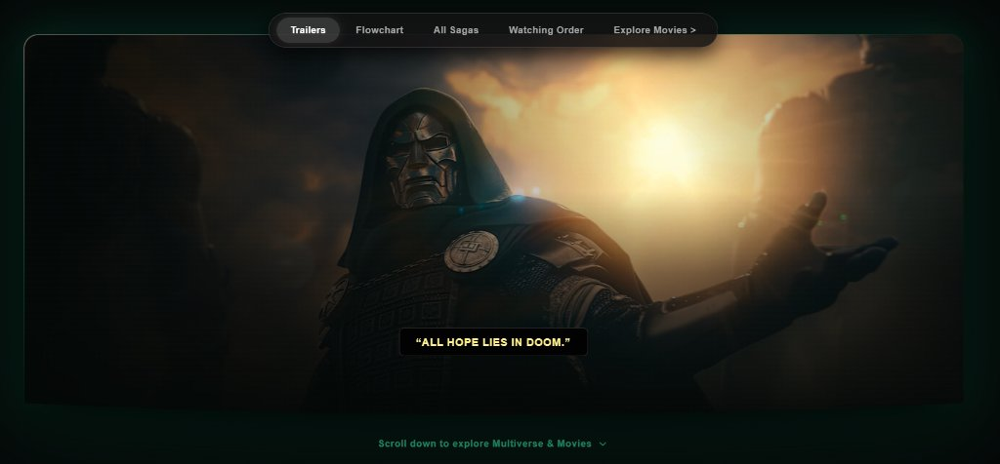
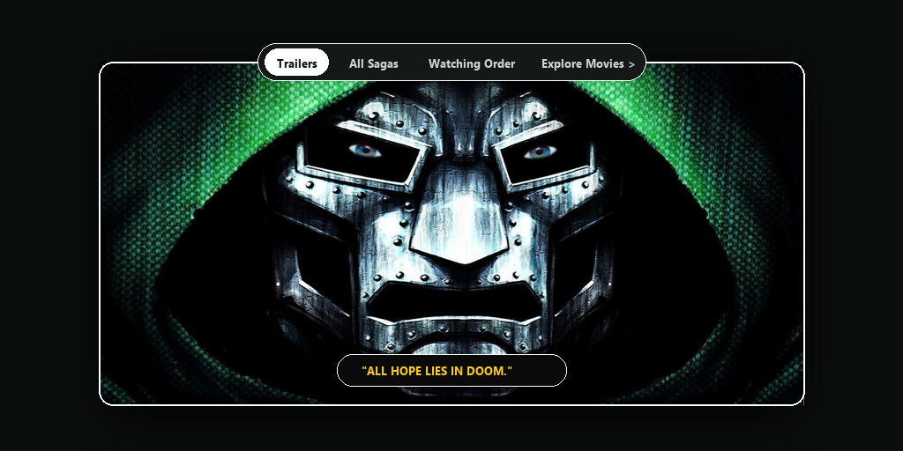
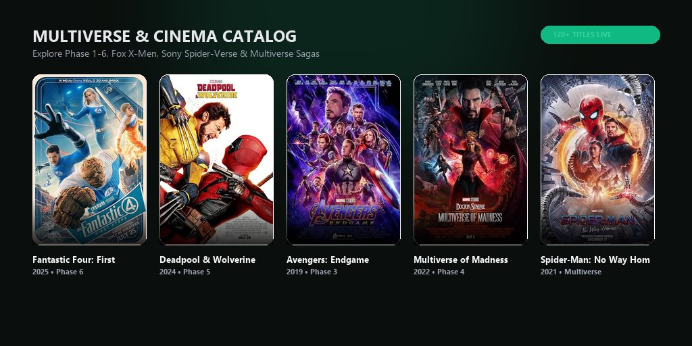
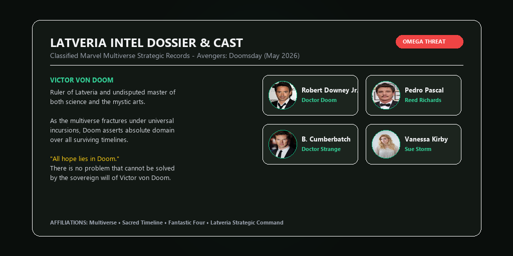

# 🌌 Avengers: Doomsday - Multiverse Cinema Hub & Marvel Explorer

<div align="center">

[](https://nextjs.org/)
[](https://react.dev/)
[](https://www.typescriptlang.org/)
[](https://tailwindcss.com/)
[](https://soorajstudio.github.io/Doomsday/)
[](LICENSE)

An ultra-cinematic Marvel multiverse web experience engineered with an authentic **Netflix-style curved billboard canvas**, **scroll-scrubbed teaser sequence**, **universal fixed floating pill navigation**, and an interactive **Multiverse & Media Catalog** featuring 120+ titles across the MCU, Fox X-Men, Sony Spider-Verse, and Defenderverse.

<br/>

<a href="https://soorajstudio.github.io/Doomsday/">
  
</a>

**[🌐 Experience Live Demo](https://soorajstudio.github.io/Doomsday/)** • **[🎬 Marvel Watch Order Guide](https://soorajstudio.github.io/Marvel-Movies)**

</div>

---

## 📸 Previews

| Authentic Netflix Cinema Screen | Multiverse & Cinema Catalog |
| :---: | :---: |
|  |  |
| **Upward-Arched Billboard & Scrubbing Canvas** | **Horizontal Snap Carousels & Dynamic Cards** |

| Latveria Intel Dossier & Cast Hub | Cinematic Teaser Experience |
| :---: | :---: |
|  |  |
| **Classified Records & Cast Roster** | **Scroll-Driven Frame Scrubbing & Subtitles** |

---

## ✨ Features

- 🎬 **Authentic Netflix Curved Cinema Billboard**: Precision-engineered screen wrapper featuring the authentic Netflix upward-arched radial mask (`radial-gradient(103% 12% at 50% 102%, transparent 50%, white 51%)`), illuminated exclusion highlight border, and realistic ambient drop shadow.
- 🎞️ **Interactive Scroll-Scrubbed Canvas**: 167-frame cinematic teaser sequence scrubbed dynamically via window scroll position with sub-pixel interpolation and synchronous subtitles engine.
- 🧭 **Universal Fixed Floating Pill Navigation**: Glassmorphic, backdrop-blurred floating pill navbar anchored across all pages with smooth in-page gliding and active state indicators.
- 🪐 **Comprehensive Multiverse Master Catalog**: Over 120+ structured Marvel screen media titles spanning the Sacred Timeline, Multiverse Saga, Fox X-Men, Sony's Spider-Man Universe (SSU), and Defenderverse.
- 🍿 **Interactive Media Modals & Cast Intel**: Deep-dive modals presenting release dates, universe affiliation, phase classifications, official decrees, and star-studded cast profiles.
- 🔗 **Dedicated Watching Order Integration**: Direct 1-click external navigation to the official [Marvel Movies Watch Order Guide](https://soorajstudio.github.io/Marvel-Movies).
- ⚡ **Zero-Server Turbopack Static Export**: Ultra-fast next-gen static export prerendering 134+ static routes with instant page loads and zero server overhead.
- 🚀 **Automated GitHub Pages CI/CD**: Automatic build, data compilation, poster asset staging, and GitHub Pages deployment workflow.
- 📱 **Fluid Responsive Layout**: Bespoke cinematic framing and touch-optimized horizontal carousel scrubbing tailored for phones, tablets, and 4K displays.

---

## 🎮 Controls & Interactions

| Action | Control / Gesture |
| :--- | :--- |
| **Cinema Canvas Scrubbing** | Scroll mouse wheel or trackpad up / down through the hero section |
| **Canvas Playback** | Click the cinema billboard to toggle automatic sequence playback / pause |
| **Explore Multiverse & Movies** | Click the floating pill button or the bottom chevron prompt to glide smoothly |
| **Inspect Media Details** | Click on any movie or series card to open the classified intel modal |
| **Open Cast & Intel Dossier** | Click **`Dossier & Cast`** for classified records and character affiliations |
| **Watching Order Guide** | Click **`Watching Order`** in the floating pill to open the comprehensive guide |
| **Close Modal Overlay** | Press **`Esc`** or click outside the modal backdrop / close button |

---

## 🛠️ Architecture & Tech Stack

| Technology | Purpose |
| :--- | :--- |
| **Next.js 16 (App Router)** | Framework powering static site generation, route handlers, and static export |
| **React 19** | Component architecture, state management, and declarative DOM updates |
| **TypeScript 5** | Strict type safety for dataset schemas, media contracts, and UI components |
| **Tailwind CSS** | Utility-first styling, glassmorphism, responsive breakpoints, and animations |
| **HTML5 Canvas API** | High-performance 60fps frame rendering for the Doctor Doom trailer sequence |
| **Lucide React** | Feather-light SVG iconography for navigation pills and modal controls |
| **GitHub Actions** | Automated CI/CD pipeline for building, exporting, and publishing to GitHub Pages |

---

## 📂 Project Structure

```text
├── apps/
│   ├── api/                     # FastAPI metadata service (optional backend)
│   └── web/                     # Next.js 16 Web Application
│       ├── public/
│       │   ├── assets/          # Posters, cast images, emblems, and wallpapers
│       │   └── sequence/        # 167-frame teaser sequence for hero canvas
│       └── src/
│           ├── app/             # Next.js App Router (pages & static routes)
│           ├── components/      # DoomHeroCanvas, AppNavbar, MediaModals, etc.
│           └── lib/             # Media dataset loaders and client utilities
├── dataset/                     # Community-maintained Marvel metadata
│   ├── data/
│   │   ├── media/               # 120+ JSON metadata files per title
│   │   ├── sagas/               # Saga metadata definitions
│   │   └── universes/           # Multiverse universe definitions
│   └── schemas/                 # Strict JSON Schemas
├── docs/
│   └── screenshots/             # High-resolution showcase & preview images
└── .github/workflows/           # GitHub Actions automated deployment
```

---

## 🚀 How to Run

### Option A: Live Website (No Installation)
Visit the live hosted deployment:
👉 **[https://soorajstudio.github.io/Doomsday/](https://soorajstudio.github.io/Doomsday/)**

---

### Option B: Run Locally (Development Server)

1. **Clone the repository**:
   ```bash
   git clone https://github.com/soorajstudio/Doomsday.git
   cd Doomsday
   ```

2. **Install dependencies & start the dev server**:
   ```bash
   cd apps/web
   npm install
   npm run dev
   ```

3. **Open in browser**:
   Navigate to `http://localhost:3000` (or `http://localhost:3001`).

---

### Option C: Build Static Production Export

```bash
cd apps/web
npm run build
```
The optimized static build will be exported directly into `apps/web/out/`.

---

## 📄 License

MIT License © 2026 [Sooraj Studio](https://github.com/soorajstudio)
